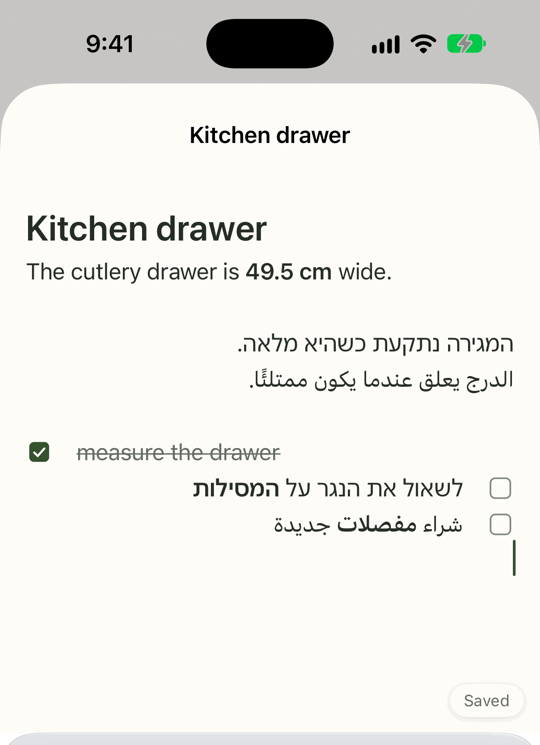
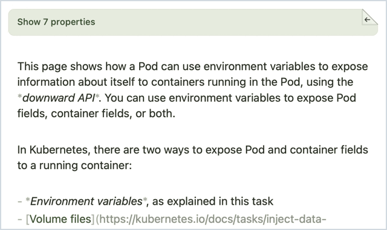

<h1 align="center">NoteKit</h1>

<p align="center">
  <strong>A native Markdown editor for your Mac and iPhone app, safe to point at an Obsidian vault.</strong>
</p>

<p align="center">
  
  
  
  
  <a href="LICENSE"></a>
</p>

<p align="center">
  <picture>
    <source media="(prefers-color-scheme: dark)" srcset="docs/media/hero-dark.gif">
    
  </picture>
  <br>
  <sub>NoteKit inside Backpocket on iPhone, in Backpocket's colors.</sub>
</p>

NoteKit edits Markdown in place, in the system's own text view: you see the Markdown itself, styled as you type. It
never rewrites a note you didn't change, and it never overwrites a change another app made.

## Features

- **Styled as you type.** Headings, emphasis, links, code, tags and callouts take their style the moment you type
  them. Away from the caret, the `#` and `**` step aside; bring the caret back and they're there, as written.
- **Tasks you can tick.** A click, a tap or ⌘⏎ ticks a task. Task boxes, bullets, quote bars and rules are drawn in
  place of their markers.
- **Right to left, line by line.** Every line takes its own direction, so right-to-left and left-to-right lines sit
  side by side in one note, task boxes and all. A name in another script doesn't turn a line around.
- **Obsidian-flavored.** `[[wikilinks|aliases]]`, `> [!callouts]`, `#tags`, `==highlights==`, YAML frontmatter,
  embeds and Templater commands. Anything it doesn't know is shown as written, never altered.
- **Your files stay yours.** Opening and closing a note writes nothing. An edit keeps the note's byte order mark, line
  endings and creation date, and lands atomically, coordinated with iCloud. [The vault check](#the-vault-check)
  proves it on a copy of your own vault.
- **Safe beside Obsidian.** If Obsidian or iCloud changes a note under unsaved edits, nothing is written until you
  choose Keep Mine or Use Theirs. With nothing unsaved, a change made elsewhere simply shows.
- **Native.** The system's TextKit 2 text view on the Mac and iPhone, so undo, spell checking, dictation and input
  methods behave the way your users expect. No dependencies.
- **Yours to shape.** Colors from the SwiftUI environment, a layout for the column and margins, and hooks for the
  rest. [More below](#make-it-yours).

## Try it

On a Mac:

```sh
git clone https://github.com/tfcace/notekit.git
cd notekit
swift run Notes
```

Choose a folder of Markdown notes (your Obsidian vault, or a copy of it while NoteKit is at v0.1) and start typing.
The Notes app is 139 lines on top of the library: a sidebar, a filter and the editor.

## Add it to your app

```swift
// Package.swift
.package(url: "https://github.com/tfcace/notekit.git", .upToNextMinor(from: "0.1.0")),

// your target's dependencies
.product(name: "NoteKit", package: "notekit"),
```

NoteKit is at v0.1.0, its first release, and the API may change as the library evolves. `.upToNextMinor` keeps you
on v0.1.x until you choose to move.

Then show a note:

```swift
import SwiftUI
import NoteKit

struct NoteView: View {
    @StateObject private var session: NoteSession

    init(url: URL) {
        _session = StateObject(wrappedValue: NoteSession(url: url))
    }

    var body: some View {
        NoteEditorView(session: session)
            // Reads the note, then watches the file for changes made elsewhere.
            .task { await session.open() }
            // Writes whatever is still pending.
            .onDisappear { Task { await session.close() } }
    }
}
```

Edits are written a moment after typing stops. Call `await NoteSession.saveAll()` before your app quits (from
`applicationShouldTerminate`, or when the scene leaves the foreground) so the last few keystrokes are written too.

A sandboxed app can only read the folder the user picks. `NotesFolder(remembering:key:)` keeps a security-scoped
bookmark of the folder you pass to `choose(_:)`, so it's still there next launch, and its `entries` list the notes,
newest first.

For a note from the folder, `NoteEditorPane(entry:)` runs the session for you: it opens the note when it appears,
saves when the app leaves the foreground, and closes (saving) when it disappears.
[`NotesView`](Sources/NotesApp/NotesView.swift), in the Notes app, puts the two together.

## Make it yours

- **Parts.** `NoteEditorView` is `NoteConflictBanner`, `NoteTextView` and `NoteSaveStatus`, and nothing else. Arrange
  your own from the same parts; `NoteEditorPane(entry:editor:)` shows it in a pane.
- **Read-only.** `editable: false` shows a note without editing it; on iPhone, `ticks: true` still lets its boxes
  tick. `fitsHeight: true` grows the view to the note's height on iPhone, for a scroll view of your own.
- **Colors.** `.noteColors(_:)` on any view sets the editor's seven colors (text, secondary, accent, onAccent,
  codeBackground, highlight, rule) for everything inside it. The default is the system's own; dynamic colors follow
  light and dark mode.
- **Layout.** `NoteTextView(session:layout:)` takes a `NoteLayout(column:margin:top:bottom:)`. On the Mac the text runs
  in a centered column at most `column` wide; on iOS the values are the text's insets.
- **Hooks.** `NoteTextView(session:hooks:)` takes a `NoteTextHooks`. It can hide ranges of the text, add room below a
  paragraph, and hear when the text loads, changes or lays out again; on the Mac it can also draw behind the text and
  take a key command or the pointer first. It reaches the editor through a `NoteEditorProxy`: the text view itself,
  and `invalidateLayout()` for when what you hide or the room you add changes. Every method has a default that does
  nothing.

The simplest hook keeps a note's frontmatter off the page:

```swift
final class HideFrontmatter: ObservableObject, NoteTextHooks {
    func hiddenRanges(in text: String) -> [NSRange] {
        Frontmatter.range(in: text).map { [$0] } ?? []
    }
}

struct PlainNoteView: View {
    let session: NoteSession
    @StateObject private var hooks = HideFrontmatter()

    var body: some View {
        NoteTextView(session: session, hooks: hooks)
    }
}
```

Hidden text takes no room, the caret can't go into it, no edit reaches it, and it's saved byte for byte.

## Built with NoteKit

NoteKit grew out of **Backpocket**, my personal curation app for notes, bookmarks and whatever else is worth keeping.
Backpocket isn't public, but its editor is NoteKit.

Backpocket keeps a note's properties on a sheet behind a strip. Click the strip's tab and it tears open; click the
sheet's corner and it folds away. Shift-Tab and Esc do the same from the keyboard. NoteKit knows nothing about any of
it: Backpocket hides the frontmatter, leaves room for the sheet, draws it behind the text and takes Shift-Tab and Esc
first, all through the hooks above.

<p align="center">
  <picture>
    <source media="(prefers-color-scheme: dark)" srcset="docs/media/properties-dark.gif">
    
  </picture>
  <br>
  <sub>Backpocket on the Mac, in editing mode: a note's properties torn open and folded away.</sub>
</p>

## Reference

### Everything the editor styles

- **Markdown:** headings, bold, italic, strikethrough, inline code and fenced blocks, links and bare addresses,
  quotes, bulleted and numbered lists, `- [ ]` tasks, rules and images.
- **Obsidian:** `[[wikilinks|aliases]]`, `![[embeds]]`, `#tags`, `==highlights==`, `> [!callouts]`, YAML frontmatter
  and Templater `<% %>` commands.

Images and embeds are shown as written, for now. Styling never changes the source.

### The session

`session.status` says what to show:

| Status | Meaning |
| --- | --- |
| `.loading` | The note is being read. |
| `.ready` | The note is open, with nothing unsaved. |
| `.editing` | Edits are waiting; they're written a moment after typing stops. |
| `.saved` | The edits are written. |
| `.changedElsewhere` | Changed in another app under unsaved edits; call `resolve(keepMine:)`. |
| `.failed(message)` | Reading or writing failed; after a failed write, `save()` tries again. |
| `.unreadable(message)` | The note isn't UTF-8 text, so it's never rewritten. |

## The vault check

```sh
NOTEKIT_VAULT=/path/to/a/copy/of/your/vault swift test --filter VaultNoOp
```

It opens every note in the folder, styles it, hands the text back unchanged and asserts that nothing was written. Run
it on a copy: if it ever fails, something was written. `swift test` runs the rest: the file contract, the scanner, the
session and the views.

## Inside

The library is the engine and the embedding API; the Notes app in the same repo is its reference consumer, and the
first thing to run when something looks wrong.

```
Sources/NoteKit/
  MarkdownStyleScanner  Markdown and Obsidian syntax to styled ranges
  NoteText              the text tied to its bytes; decides what to write
                        ParagraphDirection: each line's own direction
  NoteSession           one open note: atomic saves, outside changes, conflicts
  Frontmatter           the note's YAML block: its range and its fields
  NoteStyling           fonts and colors for the scanner's ranges
  NotePaint             draws task boxes, bullets, quote bars and rules
  NoteColors            the editor's seven colors, from the SwiftUI environment
  NoteTextView          NSTextView / UITextView wrappers for SwiftUI
  NoteTextHooks         what a host adds to the text view; NoteLayout
  NoteEditorView        the editor, its banner and status, and NoteEditorPane
  NotesFolder           the folder of notes (a vault): scan, remember, refresh
Sources/NotesApp/       the Notes app
Tests/NoteKitTests/     file contract, scanner, session, views, the vault check
scripts/build-mac.sh    builds build/Notes.app
```

The core (the scanner, `NoteText` and `NoteSession`) is Foundation only; the views need SwiftUI, and AppKit or UIKit.

Debug builds of the Notes app take `-NotesFolderPath <folder>` to use a folder without replacing the remembered one,
and `-NotesOpen <path in folder>` to open a note, for scripted runs.

## License

MIT; see [LICENSE](LICENSE). If NoteKit ends up in your app, I'd love to hear about it:
[open an issue](https://github.com/tfcace/notekit/issues) and tell me.

<p align="center"><sub>Vibecoded with ❤️</sub></p>
